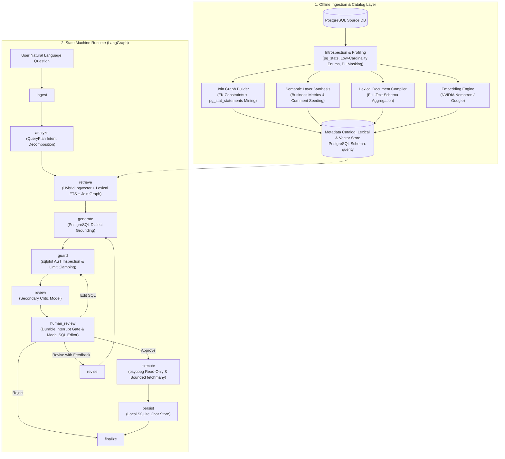
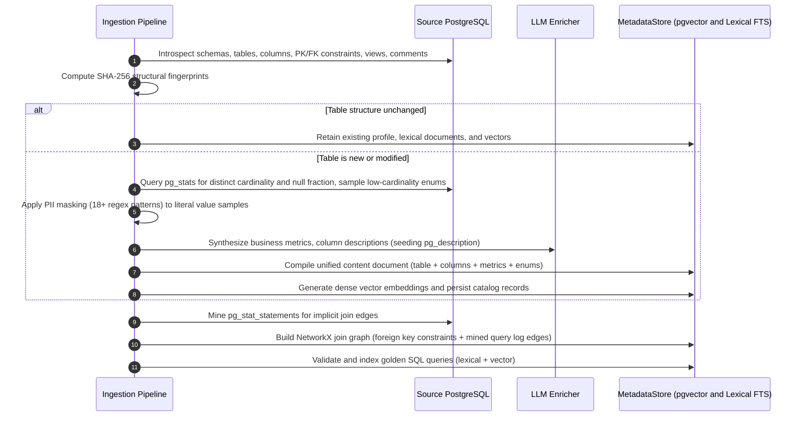
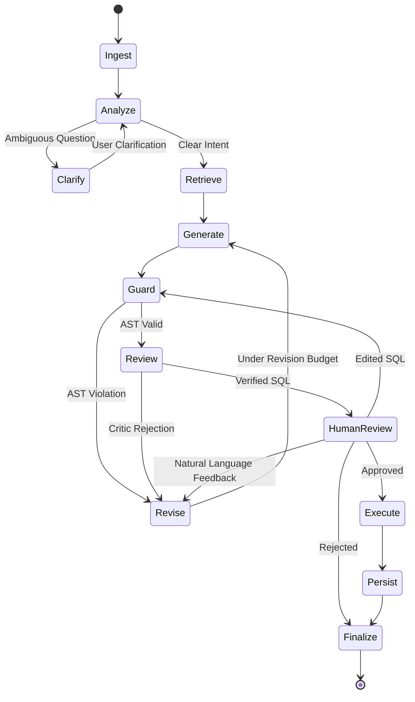
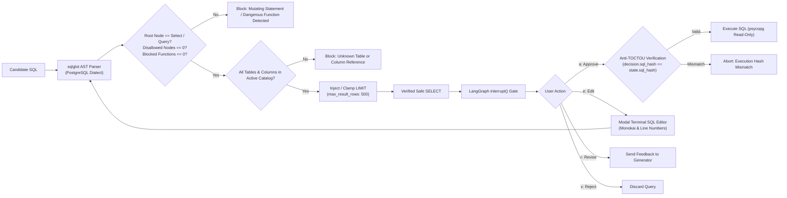

# Querity

Guarded, human-in-the-loop text-to-SQL agent and terminal interface for PostgreSQL.

Querity indexes a read-only view of your database, retrieves the relevant schema and semantic definitions for each question, and generates SQL that is validated, safe, and presented for explicit approval before execution.

---

## Architecture

Querity is engineered as a zero-trust, deterministic text-to-SQL system. Rather than relying on unstructured LLM prompting, Querity separates database profiling, relational pathfinding, semantic retrieval, query generation, and human validation into distinct architectural layers.



---

## Detailed Architectural Stages

### Stage 1: Introspection, Differential Profiling, and Ingestion

The ingestion subsystem extracts, compresses, and indexes database topology into the target PostgreSQL instance under a dedicated metadata schema (`querity`).



1. **Structural Introspection & Differential Hashing**:
   - Queries PostgreSQL system catalogs (`information_schema`, `pg_catalog`, and `pg_description`) to extract tables, views, column data types, nullability, check constraints, primary keys, foreign keys, and database comments.
   - Database comments on tables and columns are extracted as baseline semantic ground truth, automatically seeding business descriptions before LLM synthesis.
   - Computes deterministic SHA-256 fingerprints across table structures (`structural_fingerprint`), statistical distributions (`profile_fingerprint`), and semantic annotations (`enrichment_fingerprint`). Tables whose schema and profile have not changed bypass LLM re-enrichment, reducing token consumption and execution time on subsequent runs.
2. **Statistical Profiling via `pg_stats` (Zero-Load Profiling)**:
   - Rather than executing expensive `COUNT(DISTINCT ...)` table scans on multi-million row production tables, Querity extracts optimizer statistics directly from PostgreSQL's `pg_stats` system catalog (`n_distinct` and `null_frac`).
   - For negative `n_distinct` values (which represent distinct ratios relative to total rows in PostgreSQL), Querity computes estimated distinct counts by multiplying the ratio against the table's row estimate (`reltuples`), obtaining instant cardinality metrics with zero table read locks or disk I/O.
3. **Low-Cardinality Categorical Enum Extraction**:
   - Columns with cardinality below `low_cardinality_threshold` (default 50) have their distinct permitted values extracted (`SELECT DISTINCT column ORDER BY column LIMIT 51`) and embedded directly into the prompt context.
   - This equips the generation model with exact categorical literals (e.g., `status IN ('active', 'suspended', 'archived')`), eliminating hallucinated enum variants and invalid filter literals.
4. **Granular PII Masking Engine**:
   - Before row samples or column values are passed to LLMs or stored in the catalog, Querity executes regex-based PII scrubbing across 18+ sensitive patterns:
     - Identification numbers: Aadhaar, Social Security Numbers (SSN), PAN, national identity cards, passport numbers, and tax identification numbers.
     - Financial data: Credit card numbers, IBAN, bank account numbers.
     - Authentication credentials: Passwords, password hashes, secrets, API keys, access tokens, refresh tokens, private keys.
     - Contact & personal data: Email addresses, phone numbers (mobile, telephone, MSISDN), full names, dates of birth, street addresses, postal codes, and IP addresses.
   - Literals are replaced with format-preserving tokens (e.g., `***@example.com`, `***-***-**99`, `****1234`, `J***`, `***.***.***.***`) rather than blank spaces, ensuring the LLM understands formatting semantics without exposing sensitive records.
5. **Relational Join Graph Construction & Query Log Mining**:
   - **Foreign Key Topology**: Constructs a directed multigraph of table relationships using NetworkX (`querity.ingestion.join_graph`). Computes all-pairs shortest paths using Dijkstra's algorithm. When runtime queries reference disjoint tables, Querity extracts the deterministic shortest relational join path, eliminating cartesian products and join hallucination.
   - **Query Log Mining (`mine_query_log_edges`)**: For legacy schemas lacking explicit foreign key constraints, Querity can inspect `pg_stat_statements` for historical `JOIN` clauses. It parses query ASTs to extract implicit join predicates and edges, weighted by execution frequency (`calls`), automatically mapping join relationships where constraints are absent.
6. **Semantic Layer Generation**:
   - Analyzes table and column relationships to synthesize business terms, metric calculations (e.g., "Annual Recurring Revenue", "Churn Rate"), and synonym dictionaries.
7. **Dual Indexing: Lexical Full-Text Documents & Vector Embeddings**:
   - **Lexical Document Compilation**: During ingestion, Querity compiles each table's schema, physical column names, data types, primary/foreign key relationships, column descriptions, and semantic metrics into a comprehensive textual document stored in the `content` column of `querity.table_catalog`, `querity.semantic_glossary`, and `querity.golden_sql_examples`. This document serves as the ground truth for PostgreSQL's native Full-Text Search (FTS) engine (`to_tsvector('english', content)`). Lexical indexing is critical for deterministic retrieval of exact technical identifiers (e.g., `user_uuid`, `tax_exempt_status`), industry acronyms (`sku`, `arr`, `ltv`), and exact table prefixes that dense vector embeddings often compress or overlook.
   - **Dense Vector Embedding (`pgvector`)**: Generates high-dimensional vector embeddings (NVIDIA Nemotron-3 2048d or Google Gemini) from the compiled document. Persists embeddings in `querity.table_catalog` and `querity.semantic_layer` using native `vector` data types, enabling cosine distance searches (`<=>`) directly inside PostgreSQL without an external vector database.
8. **Golden Query Grounding (Dual-Indexed)**:
   - Ingests verified natural language-to-SQL pairs from an optional JSON file into `querity.golden_queries`.
   - Validates SQL syntax against the live database using `EXPLAIN` inside a transaction rollback.
   - Stores each golden query with both a dense vector embedding (for semantic question similarity) and its full question/SQL text in `content` (for exact keyword/table lexical search). Validated pairs are dynamically retrieved at runtime for few-shot in-context learning.

---

### Stage 2: LangGraph Orchestration & State Machine

Runtime query resolution is modeled as a compiled state graph (`StateGraph(AgentState)`) executed through LangGraph. State transitions are deterministic and governed by routing predicates.



#### Graph State: `AgentState`
The execution context carries immutable and mutable turn state across all nodes:
- `question`: Natural language user question.
- `plan`: Strongly typed `QueryPlan` containing decomposed intent, search terms, metrics, filters, and dimensions.
- `retrieved_tables`: Subset of tables selected by hybrid vector and topological retrieval.
- `join_subgraph`: Pre-computed join paths linking retrieved tables.
- `semantic_context`: Applicable business metrics, filters, and synonyms.
- `few_shot_examples`: Nearest golden query pairs retrieved by vector similarity.
- `sql`: Candidate SQL query.
- `sql_hash`: SHA-256 fingerprint of the candidate SQL to prevent cyclic regeneration and ensure TOCTOU safety.
- `guard_verdict`: Deterministic parser output (`valid`, `error`, `blocked`).
- `reviewer_verdict`: Critic model output (`approved`, `rejected`, `critique`).
- `revision_count`: Monotonically increasing revision counter (bounded by `max_revisions = 2`).
- `human_decision`: Decision payload (`approve`, `edit`, `revise`, `reject`).
- `execution_result`: Tabular rows, row counts, and query duration.

#### Execution Nodes & Transitions
1. `ingest`: Normalizes incoming user prompt, resets turn timers, and validates conversation context.
2. `analyze`: Deconstructs the user prompt into a structured `QueryPlan` object:
   - Evaluates whether the question is answerable against catalog summary data.
   - Extracts structured query parameters: primary `intent`, key `search_terms`, candidate `tables`, business `metrics`, operational `filters`, grouping `dimensions`, and `time_range`.
   - If semantic ambiguity or missing parameters are identified, sets `needs_clarification = True` and routes to `clarify` to prompt the user directly.
3. `retrieve`: Executes a multi-stage hybrid retrieval pipeline combining dense semantic search, sparse lexical full-text search, and relational graph expansion:
   - **Dense Semantic Retrieval**: Computes cosine distance (`<=>`) using `pgvector` to identify candidate tables, semantic glossary entries, and golden SQL examples matching the conceptual intent of the user prompt (e.g., matching "sales volume" to `orders` and `order_items`).
   - **Lexical Full-Text Search (FTS)**: Simultaneously queries PostgreSQL's native FTS engine using `websearch_to_tsquery('english', :query)` matched against `to_tsvector('english', content)` and scored using Cover Density ranking (`ts_rank_cd`). This guarantees deterministic retrieval of exact technical identifiers (e.g., column names like `customer_uuid`, exact table prefixes, or domain acronyms like `sku` and `mrr`) that vector models often compress or miss.
   - **Score Fusion**: Merges lexical and vector scores across `table_catalog`, `semantic_glossary`, and `golden_sql_examples` collections, prioritizing entities with strong combined relevance.
   - **Topological Join Expansion**: Computes a minimum spanning tree over the retrieved table set using the pre-computed NetworkX join graph. Any intermediate bridging tables required to connect disconnected entities via foreign keys are automatically pulled into the prompt context.
   - **Few-Shot Demonstration Grounding**: Retrieves the top-k nearest golden query pairs to ground the prompt in validated SQL patterns.
4. **Atomic In-Memory Cache Invalidation via Monotonic Catalog Versioning**:
   - The runtime `CatalogCache` binds cached `CatalogSnapshot` instances to monotonic version tags (`store.catalog_version(source_id)`).
   - When `/ingest` or schema modifications occur, the catalog version increments in the metadata store, automatically invalidating the in-memory cache across worker threads without requiring application restarts.
5. `generate`: Prompts the LLM with the restricted schema subset, join conditions, semantic metrics, and golden query demonstrations. Generates a structured query plan followed by a single PostgreSQL-compliant SQL query.
6. `guard`: Performs strict AST inspection using `sqlglot`. If non-SELECT constructs, write statements, or catalog violations are detected, increments `revision_count` and routes to `revise`.
7. `review`: A critic model reviews the generated SQL against the user prompt, schema constraints, and join graph. If potential logic flaws are identified, the critic's feedback is attached to the state and routed to `revise`.
8. `revise`: Aggregates errors from the guard or critic and returns execution to `generate`. If the revision budget (`max_revisions`) is exhausted, routes to `human_review` with diagnostic warnings.
9. `human_review`: Invokes LangGraph's `interrupt()`, suspending execution and checkpointing graph state to disk. Execution resumes only when the user submits an explicit decision.
10. `execute`: Establishes an isolated connection via `psycopg`, applies `SET statement_timeout`, sets the transaction to `READ ONLY`, executes the SQL, and captures truncated result previews via bounded cursor streaming.
11. `persist`: Writes query execution metrics, duration, row counts, and assistant messages into the local SQLite store (`chat.sqlite3`).
12. `finalize`: Cleans transient graph state and outputs the final response payload to the TUI.

---

### Stage 3: Deterministic SQL Guard & Human Approval



1. **Abstract Syntax Tree (AST) Inspection**:
   - Querity rejects regex-based SQL filtering. Queries are parsed into abstract syntax trees using `sqlglot` with the PostgreSQL dialect.
   - Root Node Verification: The root statement must strictly be an instance of `exp.Query` or `exp.Select`.
   - **27 Disallowed AST Node Types (`_DISALLOWED_NODES`)**: The AST is traversed to ensure complete absence of mutating or administrative operations:
     `Insert`, `Update`, `Delete`, `Create`, `Drop`, `Alter`, `Merge`, `Into`, `Command`, `Copy`, `Grant`, `Revoke`, `Transaction`, `Commit`, `Rollback`, `TruncateTable`, `Lock`, `Set`, `Reset`, `Use`, `Vacuum`, `Analyze`, `Call`, `Do`, `Listen`, `Notify`, `Unlisten`.
   - **50+ Blocked PostgreSQL Internal Functions (`_BLOCKED_FUNCTIONS`)**: Explicit blacklist targeting dangerous system calls and attack vectors:
     - Time-delay / DoS: `pg_sleep`, `pg_sleep_for`, `pg_sleep_until`.
     - Local File Inclusion & filesystem access: `pg_read_file`, `pg_read_binary_file`, `pg_ls_dir`, `pg_stat_file`.
     - Process termination & server control: `pg_terminate_backend`, `pg_cancel_backend`, `pg_reload_conf`, `pg_rotate_logfile`, `pg_switch_wal`.
     - Large Object (Blob) manipulation: `lo_import`, `lo_export`, `lo_unlink`, `lo_create`, `lowrite`, `lo_truncate`, `lo_open`.
     - Remote / cross-database execution: `dblink`, `dblink_exec`, `dblink_connect`.
     - Session state mutation & advisory locking: `set_config`, `nextval`, `setval`, `pg_advisory_lock*`, `pg_create_*_replication_slot*`, `pg_backup_*`.
   - **Single-Statement Enforcement & Comment Stripping**: Queries must contain exactly one statement (`len(statements) == 1`). Multi-statement queries separated by semicolons and queries containing NUL bytes (`\x00`) are rejected. Generated SQL cannot contain embedded SQL comments (`--`, `/* */`), neutralizing prompt injection obfuscation.
   - **AST-Level Limit Injection & Clamping**:
     - Candidate queries are inspected for a `LIMIT` clause.
     - If no `LIMIT` is specified, or if the specified limit exceeds `max_result_rows` (default 500), Querity automatically clamps the query by wrapping it into a bounded subquery:
       ```sql
       SELECT * FROM (<query>) AS _querity_result LIMIT 500
       ```
   - **Validation Caching**:
     - Verified AST results are cached in an LRU store with a 7-day TTL (or 5-minute TTL when live `EXPLAIN` validation is enabled).
     - The cache key is derived from a SHA-256 hash incorporating the normalized query, database fingerprint, catalog version, max result rows, and explain settings.
2. **Durable State Suspension (`interrupt`)**:
   - The agent relies on `langgraph-checkpoint-sqlite`. When `human_review` is reached, graph execution yields control back to the Textual event loop.
   - State is serialized in SQLite. If the user exits the terminal, shuts down the machine, or switches chats, the turn remains checkpointed and resumes cleanly upon re-opening.
3. **Anti-TOCTOU Cryptographic Hash Verification**:
   - To prevent Time-of-Check to Time-of-Use (TOCTOU) exploits or state race conditions, Querity stamps candidate SQL with a SHA-256 fingerprint (`state.sql_hash`).
   - When the user issues an approval decision, the runtime cryptographically asserts that `decision.sql_hash == state.sql_hash`. If a discrepancy exists, execution is immediately aborted.
4. **Interactive Modal SQL Editor**:
   - Selecting `edit` spawns `SQLEditScreen`, an interactive terminal modal dialog.
   - Powered by Textual's `TextArea`, the editor features Monokai syntax highlighting, line numbers, soft wrapping, and full mouse/keyboard cursor navigation.
   - Any edited query is submitted back through the `guard` node for complete AST inspection before reaching execution.
5. **Four-Way Decision Gate**:
   - `approve`: Approves the exact generated SQL for execution.
   - `edit`: Spawns the modal terminal editor for manual modification.
   - `revise`: Submits natural language feedback (e.g. "filter for active users only") back to the generator.
   - `reject`: Drops the candidate query and returns to prompt input.

---

### Stage 4: Execution Engine & Chat History Isolation

1. **Transactional Safety & Bounded Cursor Streaming**:
   - Queries are executed using `psycopg` inside an isolated transaction enforcing read-only constraints:
     ```sql
     SET LOCAL transaction_read_only = on;
     SET LOCAL statement_timeout = 15000;
     ```
   - Transactions are rolled back upon completion to ensure zero persistence of temporary objects or session-level state.
   - **Bounded Cursor Streaming (`fetchmany`)**: Rather than executing unbounded `fetchall()` (which risks terminal memory exhaustion and crashes on massive result sets), Querity streams rows using `fetchmany(max_result_rows + 1)`. This confirms whether row truncation occurred (`len(rows) > max_result_rows`) without loading unbounded records into memory.
2. **Conversation-to-Database Binding**:
   - Every conversation in `~/.local/share/querity/chat.sqlite3` is permanently stamped with a `db_fingerprint` (SHA-256 hash of normalized host, port, database, and metadata schema).
   - If a conversation is loaded against an active session pointing to a different database, Querity raises a validation error. Cross-database context leakage is physically prevented.

---

### Storage, Configuration & Concurrency Architecture

1. **Atomic Crash-Resilient Configuration Writes**:
   - When saving database connections, API keys, or user settings, Querity never overwrites configuration files directly.
   - It writes updates to a temporary file (`mkstemp(prefix=".config-", suffix=".json")`) in the target directory with strict POSIX permissions (`0o600` on files, `0o700` on parent directories), followed by an atomic `os.replace`.
   - This guarantees that configuration files cannot be corrupted by abrupt power termination and ensures credentials remain unreadable to other system accounts.
2. **Non-Blocking Asynchronous UI Workers**:
   - To maintain fluid 60fps terminal responsiveness, all heavy operations (LLM state transitions, schema ingestion, database introspection, and query execution) are offloaded from the Textual async UI event loop onto dedicated background thread workers (`@work(thread=True, exclusive=True)`).
   - The user interface remains responsive to keyboard shortcuts, scrolling, and cancellation commands even during intensive network or LLM operations.

---

## Architectural Choices & Design Rationale

| Architectural Decision | Chosen Approach | Alternative Considered | Rationale |
| :--- | :--- | :--- | :--- |
| **Metadata & Vector Storage** | PostgreSQL with `pgvector` (`querity` schema) | External Vector DB (Pinecone, Chroma, Qdrant) | **Zero external infrastructure.** Co-locating catalog metadata, join graphs, and vector embeddings inside PostgreSQL eliminates external network dependencies, synchronizes with database backups, and allows cosine distance queries directly in SQL. |
| **Catalog & Schema Retrieval** | Hybrid Retrieval (`pgvector` Cosine Distance + PostgreSQL FTS Lexical Search) | Vector-Only Retrieval (Pure Dense Embeddings) | **Precision for Technical Identifiers.** Dense vectors excel at conceptual similarity (e.g. mapping "purchases" to "orders"), but frequently fail on exact column names (e.g. `customer_uuid`, `tax_exempt_status`), acronyms (`arr`, `sku`), or specific IDs. Combining dense vectors with PostgreSQL lexical Full-Text Search (`ts_rank_cd`) ensures exact keyword matches are never missed while retaining semantic flexibility. |
| **Ingestion Profiling** | `pg_stats` System Catalog Statistics | Full Table Scans (`COUNT(DISTINCT ...)`) | **Zero Production Database Load.** Running full-table distinct counts on multi-gigabyte tables causes disk thrashing, buffer pool churn, and table lock contention. Using `pg_stats` (`n_distinct`, `null_frac`) provides instant statistical distributions with zero query overhead. |
| **Schema Grounding** | Low-Cardinality Enum Extraction ($\le 50$ values) | Unconstrained Free-Text Column Prompts | **Elimination of Filter Value Hallucinations.** Models frequently guess categorical values (e.g., generating `status = 'canceled'` when the database uses `'cancelled'`). Injecting exact enum values ensures syntactically correct filter predicates. |
| **Ingestion Lifecycle** | Database-Specific (Indexed Once, Shared Across Chats) | Chat-Specific (Indexed per Conversation) | **Performance & Token Efficiency.** Profiling a 50-table production schema takes 30-90 seconds. Indexing at the database level allows any number of chat sessions to connect instantly without re-indexing. |
| **Join Synthesis** | NetworkX Deterministic Shortest-Path Topological Graph | LLM Autonomous Join Guessing | **Elimination of Join Hallucinations.** LLMs frequently hallucinate join keys or trigger cartesian products on complex multi-table joins. Shortest-path graph expansion deterministically computes exact foreign key links. |
| **Implicit Join Discovery** | Query Log Mining (`pg_stat_statements`) | Manual Relational Annotations | **Automatic Legacy Schema Mapping.** Production databases frequently lack explicit foreign key constraints. Mining `pg_stat_statements` extracts actual production join conditions without manual documentation. |
| **SQL Safety Guard** | 27 AST Nodes & 50+ Function Blacklist via `sqlglot` | LLM System Prompting ("Do not drop tables") | **Deterministic Zero-Trust.** LLMs can be jailbroken or hallucinate mutating commands under complex prompting. AST inspection enforces grammar-level guarantees that only read-only `SELECT` statements pass. |
| **Execution Safety** | Anti-TOCTOU Cryptographic Hash Check | Blind State Execution | **Race Condition & Tamper Prevention.** Verifying `decision.sql_hash == state.sql_hash` guarantees that the exact query displayed during human review is what executes, preventing race conditions or out-of-band tampering. |
| **Result Retrieval** | Bounded Cursor Streaming (`fetchmany(LIMIT + 1)`) | Unbounded Memory Fetch (`fetchall()`) | **OOM Protection & Truncation Detection.** Streaming a bounded number of rows prevents client memory exhaustion on large result sets while deterministically verifying whether query output exceeded the row limit. |
| **Human Approval Engine** | LangGraph Durable SQLite Interrupts (`interrupt()`) | In-Memory Python `input()` Prompts | **Fault Tolerance & Asynchronous Execution.** In-memory loops lock execution threads and lose state if the terminal is closed. LangGraph checkpoints state to SQLite, allowing turns to survive crashes, disconnects, or session switches. |
| **Context Boundaries** | Immutable `db_fingerprint` per Chat Session | Dynamic Database Switching mid-chat | **Context Window Integrity.** In conversational text-to-SQL, past query history is fed into the LLM context. Switching databases within the same thread contaminates the context window, causing the LLM to query non-existent columns. |
| **Config Persistence** | Atomic File Replacement (`os.replace`, `0o600` permissions) | Direct In-Place File Overwrite | **Corruption Resistance & Credential Isolation.** Writing to temporary files with atomic swaps prevents zero-byte config corruption during process interrupts and ensures API keys are never world-readable. |
| **TUI Concurrency** | Non-Blocking Worker Threads (`@work(thread=True)`) | Single-Threaded UI Event Loop | **Smooth Interactive Performance.** Decoupling LLM network calls and database queries from the main Textual event loop ensures the terminal remains responsive at 60fps with zero interface freezes. |
| **Model Failover** | Multi-Tiered Fallback Chain (Primary -> Secondary -> Tertiary) | Single Model Endpoint | **High Availability.** Protects against vendor rate limits, transient HTTP 5xx errors, or model deprecations by automatically cascading through fallback models. |
| **Interface Platform** | Terminal UI (`Textual` + `Rich`) | Web Dashboard (React / FastAPI) | **Local Security & Native Performance.** Data engineers and developers work in the terminal. A local TUI connects natively to `localhost:5432` without Docker port mapping, network bridges, or cloud relay proxies. API keys remain local. |

---

## Installation

### Method 1: Automated Installer (Linux & macOS)

The one-line bootstrap installer configures an isolated environment and links the `querity` binary to `~/.local/bin/querity`:

```bash
curl -fsSL https://raw.githubusercontent.com/ScriptedLines/Querity/main/install.sh | bash
```

If Python 3.12+ is not installed, the script automatically provisions an isolated Python runtime via `uv` without requiring root permissions.

### Method 2: Standalone Tool via `uv`

```bash
uv tool install git+https://github.com/ScriptedLines/Querity.git
```

### Method 3: Isolated Application via `pipx`

```bash
pipx install git+https://github.com/ScriptedLines/Querity.git
```

### Method 4: From Source

```bash
git clone https://github.com/ScriptedLines/Querity.git
cd Querity
uv sync
.venv/bin/querity
```

---

## Terminal UI Reference

Type `/` at the prompt to access commands:

| Command | Aliases | Description |
| :--- | :--- | :--- |
| `/newchat` | `/new` | Start a fresh conversation on the active database. |
| `/database` | `/db`, `/switchdb` | Connect to a new database or switch between configured databases. |
| `/chats` | `/chat` | Browse, search, and switch between saved conversations. |
| `/ingest` | | Re-profile tables and refresh the catalog for the current database. |
| `/settings` | | Edit API keys, active models, and fallback chains. |
| `/status` | | View indexed table counts, schema diagnostics, and model status. |
| `/history` | | View recent questions, generated SQL, and query run stats. |
| `/config` | | Display the active configuration path and saved database profiles. |
| `/clear` | | Clear the visible transcript while preserving conversation state. |
| `/help` | `/h`, `/?` | Display the interactive command reference. |
| `/quit` | `/exit`, `/q` | Exit Querity. |

---

## Headless CLI Reference

Querity includes a headless CLI for scripting, automation, and CI/CD workflows:

```bash
# Execute a one-off natural language query
querity ask "List all active subscriptions renewing in the next 7 days"

# Force catalog re-indexing
querity ingest --force

# Ingest specific tables matching a pattern
querity ingest --table "orders*" --table "customers*"

# Inspect system status in machine-readable JSON format
querity status --json

# View configuration path and details
querity config --path
```

---

## Configuration Reference

### File Locations

- **Configuration File**: `~/.config/querity/config.json`
- **Session & History Database**: `~/.local/share/querity/chat.sqlite3`
- **Cache Directory**: `~/.cache/querity/`

### Environment Variables

| Variable | Description | Default |
| :--- | :--- | :--- |
| `SOURCE_DATABASE_URL` | PostgreSQL connection URL | None |
| `SOURCE_SCHEMAS` | Comma-separated schemas to profile | `public` |
| `METADATA_SCHEMA` | Schema where the catalog and semantic layer reside | `querity` |
| `GOOGLE_API_KEY` | Google Gemini API key | None |
| `NVIDIA_API_KEY` | NVIDIA NIM API key | None |
| `LLM_PROVIDER` | Default LLM provider (`google` or `nvidia`) | `google` |
| `LLM_MODEL` | Primary text-to-SQL generation model | `gemini-3.5-flash-lite` |
| `STATEMENT_TIMEOUT_MS` | Max execution time per query in milliseconds | `15000` |
| `MAX_RESULT_ROWS` | Max rows returned by generated queries (enforced via AST limit clamping) | `500` |
| `LOW_CARDINALITY_THRESHOLD` | Max distinct values for categorical enum value extraction | `50` |
| `PII_MASKING` | Enable regex scrubbing of sensitive patterns in row samples | `true` |
| `MINE_QUERY_LOGS` | Discover implicit joins from `pg_stat_statements` | `false` |
| `ENABLE_EXPLAIN_GUARD` | Run live PostgreSQL `EXPLAIN` query validation inside rollback transaction | `false` |
| `QUERITY_CONFIG` | Custom path to configuration JSON file | `~/.config/querity/config.json` |


---

## License

Apache License 2.0. See `LICENSE` for details.
