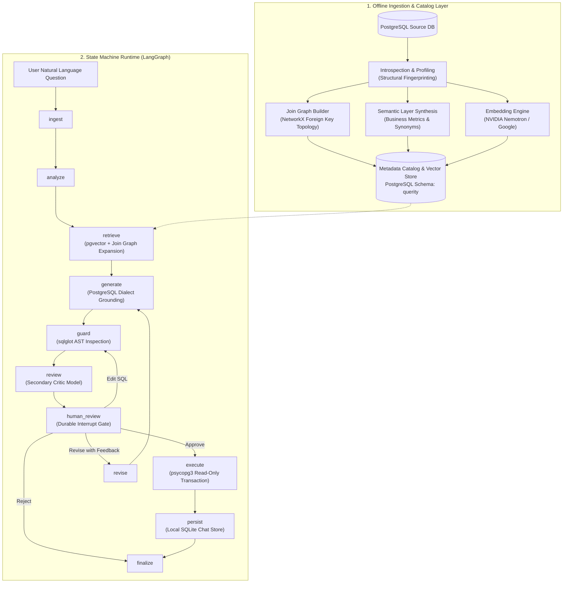
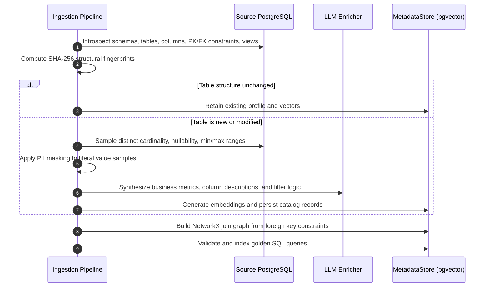
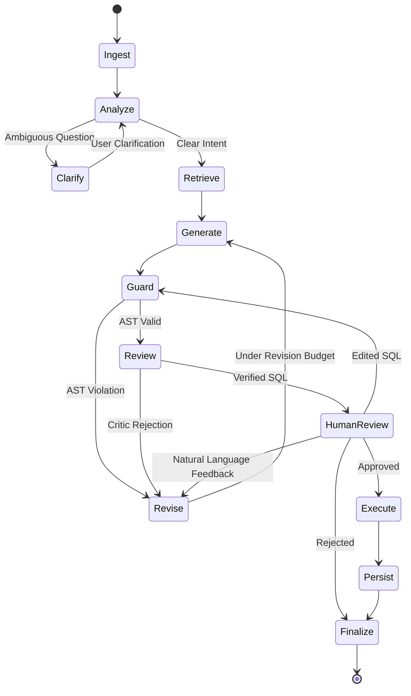
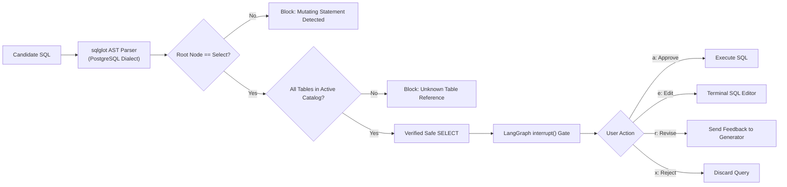

# Querity

Guarded, human-in-the-loop text-to-SQL agent and terminal interface for PostgreSQL.

Querity indexes a read-only view of your database, retrieves the relevant schema and semantic definitions for each question, and generates SQL that is validated, safe, and presented for explicit approval before execution.

---

## Architecture

Querity is engineered as a zero-trust, deterministic text-to-SQL system. Rather than relying on unstructured LLM prompting, Querity separates database profiling, relational pathfinding, semantic retrieval, query generation, and human validation into distinct architectural layers.



---

## Detailed Architectural Stages

### Stage 1: Introspection, Differential Profiling, and Ingestion

The ingestion subsystem extracts, compresses, and indexes database topology into the target PostgreSQL instance under a dedicated metadata schema (`querity`).



1. **Structural Introspection & Differential Hashing**:
   - Queries PostgreSQL system catalogs (`information_schema` and `pg_catalog`) to extract tables, views, column data types, nullability, check constraints, primary keys, and foreign keys.
   - Computes deterministic SHA-256 fingerprints across table structures (`structural_fingerprint`), statistical distributions (`profile_fingerprint`), and semantic annotations (`enrichment_fingerprint`). Tables whose schema and profile have not changed bypass LLM re-enrichment, reducing token consumption and execution time on subsequent runs.
2. **Statistical Profiling with PII Masking**:
   - Profiles column cardinality, distinct value counts, null ratios, and numeric ranges.
   - High-cardinality and sensitive patterns (e.g. passwords, tax IDs, tokens, credit cards) are scrubbed via regex-based masking rules before samples leave the machine.
3. **Relational Join Graph Construction**:
   - Constructs a directed graph of foreign key relationships using NetworkX (`querity.ingestion.join_graph`).
   - Computes all-pairs shortest paths using Dijkstra's algorithm. When runtime queries reference disjoint tables, Querity extracts the deterministic shortest relational join path, eliminating cartesian products and join hallucination.
4. **Semantic Layer Generation**:
   - Analyzes table and column relationships to synthesize business terms, metric calculations (e.g., "Annual Recurring Revenue", "Churn Rate"), and synonym dictionaries.
5. **Vector Indexing via `pgvector`**:
   - Generates high-dimensional vector embeddings (NVIDIA Nemotron-3 2048d or Google Gemini) for table summaries and semantic concepts.
   - Persists embeddings in `querity.table_catalog` and `querity.semantic_layer` using native `vector` data types, enabling cosine distance searches (`<=>`) directly inside PostgreSQL without an external vector database.
6. **Golden Query Grounding**:
   - Ingests verified SQL pairs from an optional JSON file into `querity.golden_queries`.
   - Validates SQL syntax against the live database using `EXPLAIN` inside a transaction rollback. Validated pairs are vectorized and used for few-shot dynamic prompt grounding.

---

### Stage 2: LangGraph Orchestration & State Machine

Runtime query resolution is modeled as a compiled state graph (`StateGraph(AgentState)`) executed through LangGraph. State transitions are deterministic and governed by routing predicates.



#### Graph State: `AgentState`
The execution context carries immutable and mutable turn state across all nodes:
- `question`: Natural language user question.
- `retrieved_tables`: Subset of tables selected by hybrid vector and topological retrieval.
- `join_subgraph`: Pre-computed join paths linking retrieved tables.
- `semantic_context`: Applicable business metrics, filters, and synonyms.
- `few_shot_examples`: Nearest golden query pairs retrieved by vector similarity.
- `plan`: High-level step-by-step query plan produced by the generator.
- `sql`: Candidate SQL query.
- `sql_hash`: SHA-256 fingerprint of the candidate SQL to prevent cyclic regeneration.
- `guard_verdict`: Deterministic parser output (`valid`, `error`, `blocked`).
- `reviewer_verdict`: Critic model output (`approved`, `rejected`, `critique`).
- `revision_count`: Monotonically increasing revision counter (bounded by `max_revisions = 2`).
- `human_decision`: Decision payload (`approve`, `edit`, `revise`, `reject`).
- `execution_result`: Tabular rows, row counts, and query duration.

#### Execution Nodes & Transitions
1. `ingest`: Normalizes incoming user prompt, resets turn timers, and validates conversation context.
2. `analyze`: Checks for semantic ambiguity. If the prompt cannot be resolved against the active catalog, routes to `clarify` to request user clarification.
3. `retrieve`: Executes hybrid retrieval:
   - Evaluates vector cosine distance against `querity.table_catalog` to identify top candidate tables.
   - Evaluates BM25 keyword matching against table names and column descriptions.
   - Performs join graph expansion: computes the minimum spanning tree over the candidate tables to include necessary intermediate bridging tables.
   - Retrieves top-k nearest golden query examples from `querity.golden_queries`.
4. `generate`: Prompts the LLM with the restricted schema subset, join conditions, semantic metrics, and golden query demonstrations. Generates a structured query plan followed by a single PostgreSQL-compliant SQL query.
5. `guard`: Performs strict AST inspection using `sqlglot`. If non-SELECT constructs, write statements, or catalog violations are detected, increments `revision_count` and routes to `revise`.
6. `review`: A critic model reviews the generated SQL against the user prompt, schema constraints, and join graph. If potential logic flaws are identified, the critic's feedback is attached to the state and routed to `revise`.
7. `revise`: Aggregates errors from the guard or critic and returns execution to `generate`. If the revision budget (`max_revisions`) is exhausted, routes to `human_review` with diagnostic warnings.
8. `human_review`: Invokes LangGraph's `interrupt()`, suspending execution and checkpointing graph state to disk. Execution resumes only when the user submits an explicit decision.
9. `execute`: Establishes an isolated connection via `psycopg`, applies `SET statement_timeout`, sets the transaction to `READ ONLY`, executes the SQL, and captures truncated result previews.
10. `persist`: Writes query execution metrics, duration, row counts, and assistant messages into the local SQLite store (`chat.sqlite3`).
11. `finalize`: Cleans transient graph state and outputs the final response payload to the TUI.

---

### Stage 3: Deterministic SQL Guard & Human Approval



1. **Abstract Syntax Tree (AST) Inspection**:
   - Querity rejects regex-based SQL filtering. Queries are parsed into abstract syntax trees using `sqlglot`.
   - The root AST node must be an instance of `exp.Select`. Any appearance of mutating expressions (`exp.Insert`, `exp.Update`, `exp.Delete`, `exp.Drop`, `exp.AlterTable`, `exp.TruncateTable`, `exp.Command`) results in immediate rejection.
   - Referenced table identifiers are checked against the active catalog. Queries attempting to access internal schemas or unindexed tables are blocked.
2. **Durable State Suspension (`interrupt`)**:
   - The agent relies on `langgraph-checkpoint-sqlite`. When `human_review` is reached, graph execution yields control back to the Textual event loop.
   - State is serialized in SQLite. If the user exits the terminal, shuts down the machine, or switches chats, the turn remains checkpointed and resumes cleanly upon re-opening.
3. **Four-Way Decision Gate**:
   - `approve`: Approves the exact generated SQL for execution.
   - `edit`: Spawns a modal terminal editor with syntax highlighting. The edited query is re-routed through `guard` before execution.
   - `revise`: Submits natural language feedback (e.g. "filter for active users only") back to the generator.
   - `reject`: Drops the candidate query and returns to prompt input.

---

### Stage 4: Execution Engine & Chat History Isolation

1. **Transactional Safety**:
   - Queries are executed using `psycopg` with parameters enforcing read-only constraints:
     ```sql
     SET LOCAL transaction_read_only = on;
     SET LOCAL statement_timeout = 15000;
     ```
   - Transactions are rolled back upon completion to ensure zero persistence of temporary objects or session-level state.
2. **Conversation-to-Database Binding**:
   - Every conversation in `~/.local/share/querity/chat.sqlite3` is permanently stamped with a `db_fingerprint` (SHA-256 hash of normalized host, port, database, and metadata schema).
   - If a conversation is loaded against an active session pointing to a different database, Querity raises a validation error. Cross-database context leakage is physically prevented.

---

## Architectural Choices & Design Rationale

| Architectural Decision | Chosen Approach | Alternative Considered | Rationale |
| :--- | :--- | :--- | :--- |
| **Metadata & Vector Storage** | PostgreSQL with `pgvector` (`querity` schema) | External Vector DB (Pinecone, Chroma, Qdrant) | **Zero external infrastructure.** Co-locating catalog metadata, join graphs, and vector embeddings inside PostgreSQL eliminates external network dependencies, synchronizes with database backups, and allows cosine distance queries directly in SQL. |
| **Ingestion Lifecycle** | Database-Specific (Indexed Once, Shared Across Chats) | Chat-Specific (Indexed per Conversation) | **Performance & Token Efficiency.** Profiling a 50-table production schema takes 30–90 seconds. Indexing at the database level allows any number of chat sessions to connect instantly without re-indexing. |
| **Join Synthesis** | NetworkX Deterministic Shortest-Path Topological Graph | LLM Autonomous Join Guessing | **Elimination of Join Hallucinations.** LLMs frequently hallucinate join keys or trigger cartesian products on complex multi-table joins. Shortest-path graph expansion deterministically computes exact foreign key links. |
| **SQL Safety Guard** | AST Analysis via `sqlglot` | LLM System Prompting ("Do not drop tables") | **Deterministic Zero-Trust.** LLMs can be jailbroken or hallucinate mutating commands under complex prompting. AST inspection enforces grammar-level guarantees that only read-only `SELECT` statements pass. |
| **Human Approval Engine** | LangGraph Durable SQLite Interrupts (`interrupt()`) | In-Memory Python `input()` Prompts | **Fault Tolerance & Asynchronous Execution.** In-memory loops lock execution threads and lose state if the terminal is closed. LangGraph checkpoints state to SQLite, allowing turns to survive crashes, disconnects, or session switches. |
| **Context Boundaries** | Immutable `db_fingerprint` per Chat Session | Dynamic Database Switching mid-chat | **Context Window Integrity.** In conversational text-to-SQL, past query history is fed into the LLM context. Switching databases within the same thread contaminates the context window, causing the LLM to query non-existent columns. |
| **Model Failover** | Multi-Tiered Fallback Chain (Primary -> Secondary -> Tertiary) | Single Model Endpoint | **High Availability.** Protects against vendor rate limits, transient HTTP 5xx errors, or model deprecations by automatically cascading through fallback models. |
| **Interface Platform** | Terminal UI (`Textual` + `Rich`) | Web Dashboard (React / FastAPI) | **Local Security & Native Performance.** Data engineers and developers work in the terminal. A local TUI connects natively to `localhost:5432` without Docker port mapping, network bridges, or cloud relay proxies. API keys remain local. |

---

## Installation

### Method 1: Automated Installer (Linux & macOS)

The one-line bootstrap installer configures an isolated environment and links the `querity` binary to `~/.local/bin/querity`:

```bash
curl -fsSL https://raw.githubusercontent.com/<username>/<repo>/main/install.sh | bash
```

If Python 3.12+ is not installed, the script automatically provisions an isolated Python runtime via `uv` without requiring root permissions.

### Method 2: Standalone Tool via `uv`

```bash
uv tool install git+https://github.com/<username>/<repo>.git
```

### Method 3: Isolated Application via `pipx`

```bash
pipx install git+https://github.com/<username>/<repo>.git
```

### Method 4: From Source

```bash
git clone https://github.com/<username>/<repo>.git
cd querity
uv sync
.venv/bin/querity
```

---

## Terminal UI Reference

Type `/` at the prompt to access commands:

| Command | Aliases | Description |
| :--- | :--- | :--- |
| `/newchat` | `/new` | Start a fresh conversation on the active database. |
| `/database` | `/db`, `/switchdb` | Connect to a new database or switch between configured databases. |
| `/chats` | `/chat` | Browse, search, and switch between saved conversations. |
| `/ingest` | | Re-profile tables and refresh the catalog for the current database. |
| `/settings` | | Edit API keys, active models, and fallback chains. |
| `/status` | | View indexed table counts, schema diagnostics, and model status. |
| `/history` | | View recent questions, generated SQL, and query run stats. |
| `/config` | | Display the active configuration path and saved database profiles. |
| `/clear` | | Clear the visible transcript while preserving conversation state. |
| `/help` | `/h`, `/?` | Display the interactive command reference. |
| `/quit` | `/exit`, `/q` | Exit Querity. |

---

## Headless CLI Reference

Querity includes a headless CLI for scripting, automation, and CI/CD workflows:

```bash
# Execute a one-off natural language query
querity ask "List all active subscriptions renewing in the next 7 days"

# Force catalog re-indexing
querity ingest --force

# Ingest specific tables matching a pattern
querity ingest --table "orders*" --table "customers*"

# Inspect system status in machine-readable JSON format
querity status --json

# View configuration path and details
querity config --path
```

---

## Configuration Reference

### File Locations

- **Configuration File**: `~/.config/querity/config.json`
- **Session & History Database**: `~/.local/share/querity/chat.sqlite3`
- **Cache Directory**: `~/.cache/querity/`

### Environment Variables

| Variable | Description | Default |
| :--- | :--- | :--- |
| `SOURCE_DATABASE_URL` | PostgreSQL connection URL | None |
| `SOURCE_SCHEMAS` | Comma-separated schemas to profile | `public` |
| `METADATA_SCHEMA` | Schema where the catalog and semantic layer reside | `querity` |
| `GOOGLE_API_KEY` | Google Gemini API key | None |
| `NVIDIA_API_KEY` | NVIDIA NIM API key | None |
| `LLM_PROVIDER` | Default LLM provider (`google` or `nvidia`) | `google` |
| `LLM_MODEL` | Primary text-to-SQL generation model | `gemini-3.5-flash-lite` |
| `STATEMENT_TIMEOUT_MS` | Max execution time per query in milliseconds | `15000` |
| `QUERITY_CONFIG` | Custom path to configuration JSON file | `~/.config/querity/config.json` |

---

## Packaging & Releases

To build distribution packages for release:

```bash
uv build
```

This generates:
- Distribution wheel: `dist/querity-<version>-py3-none-any.whl`
- Source distribution: `dist/querity-<version>.tar.gz`

To publish to PyPI:

```bash
uv publish
```

---

## License

Apache License 2.0. See `LICENSE` for details.
