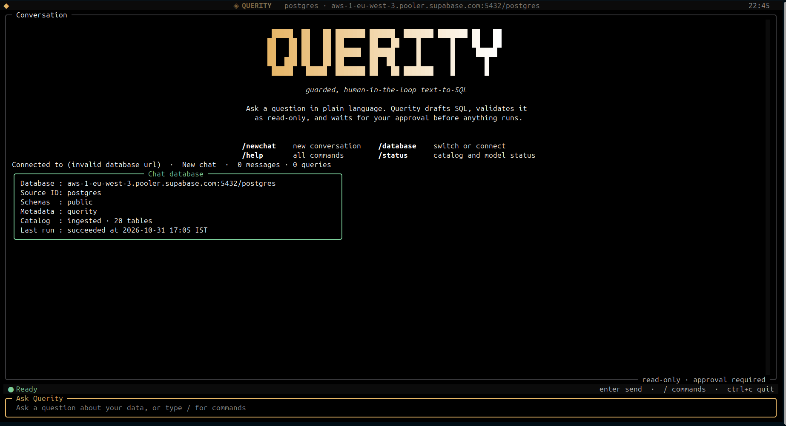
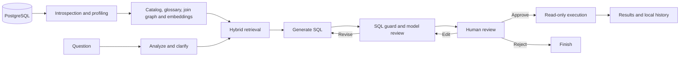

# Querity

Querity is a human-in-the-loop text-to-SQL agent for PostgreSQL. It builds a searchable catalog of a database, uses that catalog to generate SQL from natural-language questions, checks the SQL, and presents it for review before normal execution. A terminal interface supports conversations, database switching, and query history.

<p align="center">
  
</p>

## Features

- **Schema-aware generation:** introspects tables, columns, keys, relationships, comments, and optional views; profiles data and enriches the catalog with descriptions.
- **Hybrid retrieval:** combines PostgreSQL full-text search and pgvector similarity with a NetworkX join graph to select relevant schema, business definitions, and example SQL.
- **Agent workflow:** uses a LangGraph state machine for intent analysis, clarification, retrieval, generation, SQL validation, model review, and bounded revisions.
- **Review and execution:** lets users approve, edit, request changes, or reject SQL. The guard checks parsed SQL and catalog references; execution uses a read-only transaction, a timeout, and bounded result fetching.
- **Local terminal experience:** Textual and Rich provide chat, database profiles, SQL review, history, and status; SQLite stores history, checkpoints, and cached responses locally.
- **Evaluation:** a benchmark runner compares generated and golden queries on a configured database and reports retrieval, execution, result-comparison, and latency metrics.

## How it works



### Ingestion and retrieval

1. Querity inspects the configured PostgreSQL schemas and collects structural metadata, comments, primary and foreign keys. It reads planner statistics from `pg_stats` and may query source tables for bounded samples and distinct values. Statistics can be missing or stale, and sampling and distinct-value queries do place load on the source database.
2. Structural, profile, and enrichment fingerprints support incremental ingestion. Unchanged records can be reused; `--force` and `--refresh-profiles` provide refresh options. Table and column names identified as sensitive are excluded or masked during profiling, with configurable patterns.
3. Optional LLM enrichment produces descriptions; an optional generated or curated semantic layer supplies business metrics and filters. Foreign keys form a join graph. Optional `pg_stat_statements` mining can add inferred joins when that extension and its statistics are available.
4. Catalog entries, glossary entries, and golden examples are stored with embeddings in PostgreSQL. At question time, vector similarity and PostgreSQL full-text search rank candidates; graph paths can bring connecting tables into the context. Search and generated SQL are probabilistic and may miss relevant data or produce incorrect answers.

The normal CLI uses the selected database for both source data and the metadata schema, `querity` by default. Ingestion creates and updates metadata there, so the connection needs the relevant schema/table privileges and access to the `vector` extension. The application-level source reads and generated-query transactions use read-only connections; the overall CLI connection is therefore not a read-only database account. The lower-level settings also support a separate metadata database through `SUPABASE_DATABASE_URL` or `METADATA_DATABASE_URL`.

### Validation and approval

The SQL guard parses PostgreSQL SQL with `sqlglot`, rejects multiple statements and disallowed AST nodes and functions, checks catalog references, and adds or clamps a result limit. By default it also runs `EXPLAIN` to validate the query against PostgreSQL. A model reviews the query and can request revisions. Generated SQL is shown for approval; edited SQL is checked again. Approval can include a SQL hash, which is checked when supplied. Query execution uses a read-only transaction and statement timeout, and fetches at most the configured limit plus one row for truncation detection. Result previews mask columns identified as sensitive.

These controls reduce risk but do not guarantee that a query is safe, inexpensive, correct, or free of sensitive data. Pattern-based masking can miss data, and `LIMIT` does not bound the work required to calculate a result. Review queries and grant only the database privileges appropriate to the deployment. Schema metadata, sampled values, questions, and other context may be sent to configured model and embedding providers; local configuration contains credentials.

The normal interactive query flow asks for a decision. The benchmark runner is different: it automatically approves queries awaiting approval and executes generated and golden SQL against the configured database. Use a suitable test database and review your golden queries before running it.

### Technology

Python 3.12+, LangGraph and LangChain, PostgreSQL and pgvector, SQLAlchemy and psycopg 3, sqlglot, NetworkX, Pydantic, Textual, Rich, and SQLite. Text generation supports Google and NVIDIA providers; embeddings currently use NVIDIA (default `nvidia/nemotron-3-embed-1b`, 2048 dimensions). Primary, secondary, and tertiary text models can be configured for fallback.

## Getting started

### Prerequisites

- Python 3.12 or later, and `uv` or `pipx` for the installation methods below.
- A reachable PostgreSQL database with pgvector available. The selected role needs access to the source schemas and permission to create or use the metadata schema and its tables; installing the extension may require additional privileges.
- An NVIDIA API key for embeddings, plus a Google API key when using the default Google text model. Provider access, model availability, and API usage charges depend on the provider.

### Install

From source:

```bash
git clone https://github.com/ScriptedLines/Querity.git
cd Querity
uv sync
uv run querity init
uv run querity ingest
uv run querity
```

`querity init` guides you through connection and provider configuration. Ingestion must complete successfully enough to produce an active catalog before asking questions. The terminal UI can also guide database selection and ingestion. To check the installation or catalog, run `uv run querity version` and `uv run querity status`. When installed as a tool, omit `uv run`.

Alternatively, install directly from the repository:

```bash
uv tool install git+https://github.com/ScriptedLines/Querity.git
# or
pipx install git+https://github.com/ScriptedLines/Querity.git
```

The repository also includes `install.sh` for macOS/Linux and `install.ps1` for Windows. Review an installer before running it.

## Usage

Run `querity` or `querity chat` for the interactive terminal UI. Enter a question, inspect the proposed SQL and diagnostics, then choose an action. A one-off `querity ask` still prompts for clarification and approval; it is not an unattended execution command.

```bash
querity init                         # configure connection and models
querity ask "List the ten most recent orders"
querity ingest                       # refresh the catalog
querity ingest --force               # re-profile every table
querity ingest --table 'orders*' --table 'customers*'
querity ingest --dry-run             # profile without writing catalog changes
querity ingest --refresh-profiles
querity ingest --semantic            # generate semantic definitions
querity ingest --no-llm              # disable LLM enrichment for this run
querity ingest --golden-queries path/to/golden.json
querity status --json
querity config --path
querity cache stats
querity cache clear
querity version
```

Use `querity --help` and `querity <command> --help` for available options. In the TUI, type `/` for commands:

| Command | Aliases | Purpose |
| --- | --- | --- |
| `/newchat` | `/new` | Start a conversation. |
| `/database` | `/db`, `/switchdb` | Connect to or switch databases. |
| `/chats` | `/chat` | Browse and switch saved conversations. |
| `/ingest` | | Refresh the current database catalog. |
| `/settings` | | Edit API keys and models. |
| `/status` | | Show catalog, model, and conversation status. |
| `/history` | | Show recent messages and query runs. |
| `/config` | | Show configuration and saved databases. |
| `/clear` | | Clear the visible transcript. |
| `/help` | `/h`, `/?` | Show commands. |
| `/quit` | `/exit`, `/q` | Exit. |

### Semantic definitions and golden examples

A curated YAML semantic layer can define `metrics` and `filters` with names, synonyms, descriptions, table references, and SQL formulas or conditions. Set `SEMANTIC_LAYER_PATH` when using the lower-level settings or configure the corresponding `semantic_layer_path` setting. Curated entries take precedence over generated duplicates.

Golden examples are JSON records containing `question`, `sql`, and optionally `tables`, `tags`, and `notes`. They can be ingested for retrieval as examples and used for benchmarks. The bundled [data/golden_queries.json](data/golden_queries.json) targets a particular example commerce schema; replace it with examples valid for your database. By default, ingestion validates golden SQL with PostgreSQL `EXPLAIN`. A minimal record looks like:

```json
[
  {
    "question": "How many orders are there?",
    "sql": "SELECT COUNT(*) AS order_count FROM public.orders",
    "tables": ["public.orders"]
  }
]
```

## Configuration and storage

`querity init` saves a JSON configuration in the platform-specific `querity` config directory (typically `~/.config/querity/config.json` on Linux). Set `QUERITY_CONFIG` to change the path. It stores database URLs and API keys; Querity attempts to restrict file permissions to the current user. Local platform data directories contain `history.sqlite3`, `checkpoints.sqlite3`, and `cache.sqlite3` (typically `~/.local/share/querity/` on Linux). Paths differ by operating system and can be overridden through agent settings.

The CLI loads a saved configuration when present. Without one, it can bootstrap selected settings from environment variables if `SOURCE_DATABASE_URL` is set. Saved CLI fields are explicitly passed to the settings object, so changing their environment counterparts does not necessarily override a saved configuration. Lower-level `IngestionSettings`/`AgentSettings` also support environment variables and `.env`; the CLI's settings conversion disables `.env` loading. Use `querity config`, `querity config --path`, and `querity <command> --help` to inspect your setup.

Important settings and lower-level environment aliases:

| Setting | Purpose | Default |
| --- | --- | --- |
| `SOURCE_DATABASE_URL` | Source PostgreSQL URL. | Required for database operations |
| `SUPABASE_DATABASE_URL` / `METADATA_DATABASE_URL` | Separate metadata PostgreSQL URL for lower-level settings. The CLI uses its selected database for both. | None |
| `SOURCE_ID`, `SOURCE_SCHEMAS`, `METADATA_SCHEMA` | Catalog identity, source schemas, and metadata schema. | `default`, `public`, `querity` |
| `INCLUDE_VIEWS`, `TABLE_INCLUDE`, `TABLE_EXCLUDE` | Include views and filter tables. | `false`, empty, empty |
| `GOOGLE_API_KEY`, `NVIDIA_API_KEY` | Provider credentials. | None |
| `LLM_PROVIDER`, `LLM_MODEL` | Text model provider and primary model. | `google`, `gemini-3.5-flash-lite` |
| `LLM_SECONDARY_MODEL`, `LLM_TERTIARY_MODEL`, `AGENT_REVIEW_MODEL` | Fallback and review models. | `gemini-3.1-flash-lite`, `gemini-2.5-flash-lite`, primary model |
| `ENABLE_LLM`, `GENERATE_SEMANTIC_LAYER` | Ingestion enrichment and semantic generation. | `true`, `false` in lower-level settings; CLI semantic generation defaults to `true` |
| `EMBEDDING_PROVIDER`, `EMBEDDING_MODEL`, `EMBEDDING_DIMENSIONS`, `EMBEDDING_INDEX` | Embedding provider, model, dimensions, and index type. | `nvidia`, `nvidia/nemotron-3-embed-1b`, `2048`, `none` |
| `LOW_CARDINALITY_THRESHOLD`, `PII_MASKING`, `SENSITIVE_COLUMN_PATTERNS` | Profiling threshold and sensitive-column handling. | `50`, `true`, empty |
| `MINE_QUERY_LOGS`, `QUERY_LOG_LIMIT` | Optional `pg_stat_statements` join mining. | `false`, `500` |
| `SEMANTIC_LAYER_PATH`, `GOLDEN_QUERIES_PATH`, `VALIDATE_GOLDEN_SQL` | Curated definitions, examples, and example validation. | None, None, `true` |
| `STATEMENT_TIMEOUT_MS`, `AGENT_STATEMENT_TIMEOUT_MS` | Ingestion and agent query timeouts. | `15000`, `15000` |
| `AGENT_MAX_RESULT_ROWS`, `AGENT_MAX_PREVIEW_ROWS` | Maximum execution rows and displayed preview rows. | `500`, `50` |
| `AGENT_MAX_REVISIONS`, `AGENT_MAX_HUMAN_REVISIONS` | Automatic and human revision limits. | `2`, `10` |
| `AGENT_ENABLE_CLARIFICATION`, `AGENT_ENABLE_EXPLAIN_GUARD` | Clarification and live `EXPLAIN` validation. | `true`, `true` |
| `AGENT_DATA_DIR`, `AGENT_HISTORY_DB`, `AGENT_CHECKPOINT_DB` | Override local data and SQLite paths. | Platform data directory |
| `AGENT_CACHE_ENABLED`, `AGENT_CACHE_DB`, `AGENT_CACHE_MAX_BYTES` | Enable, locate, and limit the local cache. | `true`, platform data directory, `268435456` |
| `LOG_LEVEL`, `LOG_JSON` | Logging level and JSON output. | `INFO`, `false` |

The CLI's environment bootstrap uses `MAX_RESULT_ROWS` and `MAX_REVISIONS` for its saved-style fields; lower-level settings use the `AGENT_` aliases shown above. See [ingestion settings](src/querity/ingestion/settings.py), [agent settings](src/querity/agent/settings.py), and [CLI configuration](src/querity/cli/config.py) for the complete fields, bounds, and precedence. HNSW is limited to 2000 dimensions by the settings validation; the default 2048-dimensional embedding uses no HNSW index.

The local SQLite cache uses WAL and stores embedding, retrieval, and guard entries with expiration and size-based pruning. An in-memory catalog cache tracks the catalog version for invalidation. `querity cache stats` reports entries and size; `querity cache clear` clears the cache.

## Benchmarking

```bash
querity benchmark --golden-path path/to/golden.json --limit 5
querity benchmark --golden-path path/to/golden.json --output-dir benchmarks/runs
querity benchmark --golden-path path/to/golden.json --min-success-rate 90 --fail-on-threshold
```

The runner records per-query and aggregate metrics, including table recall and precision, guard and execution success, result comparisons, and stage latency. It writes JSON, JSONL, Markdown, and log artifacts under the output directory. Threshold flags can make the command fail for CI; run `querity benchmark --help` for the full list. Results depend on the dataset, models, database, and configuration; no benchmark score is claimed here. The default golden path is relative to the current working directory.

## Development

```bash
uv sync --all-groups
uv run pytest tests/
uv run ruff check .
uv build
```

Source is under [src/querity](src/querity): `ingestion` builds the catalog, `agent` handles retrieval and query execution, `cli` provides the terminal and commands, `benchmarks` evaluates queries, and `common` contains shared cache and masking utilities. Tests cover these components under [tests](tests). GitHub Actions runs the test suite and package build on pushes and pull requests to `main`.

## License

No license file is currently included in this repository. Add one before stating distribution or reuse terms.
